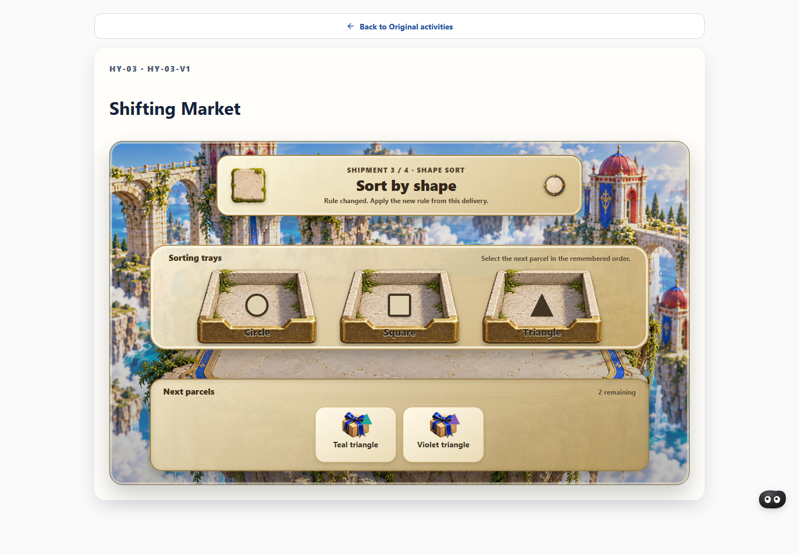

# AI4BRAIN — Cognitive Growth Agent

AI4BRAIN is a **non-clinical cognitive practice prototype** connecting five short task families to an evidence-based profile, an explorable Brain Twin, personalized plans and an AI companion. Its core loop is **attempt → recorded evidence → understandable feedback → adaptive practice → review**.



*Actual application screen from an isolated synthetic QA session. The shapes and results are example data, not participant records.*

> **For the jury:** Begin with the quick start and walkthrough below. The app produces preliminary task observations—not diagnoses, IQ scores, normative percentiles or proof of cognitive improvement. This is a work in progress; limitations are stated below.

## What it does

- **Assess:** Five families—working memory, reasoning, attention/inhibition, flexibility and planning—use versioned tasks and server-side evaluation.
- **Understand:** Results retain source records, counts and uncertainty. The Brain Twin presents a navigable evidence graph with a keyboard-accessible list and record inspection.
- **Coach:** A companion explains recorded observations. Local grounded responses work without a hosted model; optional Gemini or Groq explanations require server configuration and learner consent. Fallback is identified.
- **Adapt:** Plans use goals, time and availability. Four-attempt training blocks can produce explainable UP, HOLD or DOWN decisions; assistance and interruptions are recorded separately.
- **Practice:** Six hybrid activities and a separately versioned Crystal Reasoning form extend practice without changing the five baseline indices.

## Quick start

### Docker Compose

Install Docker Desktop with Linux containers. From the repository root in PowerShell:

```powershell
.\scripts\compose-up.ps1
```

Open **http://localhost:8080**. The helper prepares local configuration when needed, builds the stack and waits for health. It uses separate persistent volumes; it does not silently import an existing native learner database. The first build and optional speech-model download require internet access.

| Address | Service |
|---|---|
| http://localhost:8080 | Application |
| http://localhost:8080/docs | API documentation |
| http://localhost:8080/health | API health |
| http://localhost:7475/browser/ | Neo4j Browser; credentials are in local `.env` |

On Linux/macOS, copy `.env.example` to `.env`, set a Neo4j password of at least eight characters, then run:

```sh
docker compose up --build --detach --wait --wait-timeout 240
docker compose ps
```

`docker compose stop` stops the stack without deleting data. **Do not commit or share `.env`**; removing named volumes deletes their stored data. See [the Docker guide](docs/DOCKER.md) for ports, backup and optional import.

### Windows native development

Requires Python 3.11+, Node.js 20.19+ and npm:

```powershell
.\scripts\setup.ps1
.\scripts\start.ps1
```

Open http://localhost:5173. Stop with `.\scripts\stop.ps1`. Native and Compose data are separate unless deliberately configured otherwise.

## Suggested jury walkthrough

Use a fresh or explicitly synthetic profile. A full five-family baseline takes longer than a short demo.

1. **Play:** Read the consent notice, enter a world and complete practice and its baseline. Try the other families to see different mechanics.
2. **Insights:** Inspect the family result, source counts and uncertainty. Unfinished families remain unassessed; the indices are task-specific, not clinical scales.
3. **Evidence:** Select a family, pan or zoom, choose a record and inspect its source. The keyboard node list is an alternative to the visual graph.
4. **Plan and practice:** Set a goal and time budget, inspect the proposed step and reason, complete a training block and inspect its actual decision and evidence.
5. **Companion and collaboration:** Ask about saved evidence and inspect its citations, provider status and optional explanations. Scored phases remain quiet; requested practice help is recorded as assistance.
6. **Additional activities and privacy:** Explore the hybrids and Crystal form, then inspect the notice, local data controls and export. Use disposable data for deletion tests.

## Tasks and scoring

The five baselines contain **79 eligible items**. These are brief authored tasks, not validated diagnostic instruments.

| Family | Example task | Baseline index | Limitations |
|---|---|---|---|
| Working memory | Recall spatial sequences | Correct positions out of 24, scaled to 100 | Vision, familiarity and input precision |
| Reasoning | Complete visual patterns | Correct answers out of 6, scaled to 100 | Small authored bank; pattern familiarity |
| Attention/inhibition | Respond to Go and withhold on No-go | Equal weighting of Go hit and No-go correct-rejection rates | Timing, motor response, fatigue and distractions |
| Flexibility | Apply changing sorting rules | Equal weighting of switch and repeat accuracy | Rule comprehension and visual/reading demands |
| Planning | Complete legal routes efficiently | Mean efficiency against a shortest legal route; incomplete puzzles score zero | Sparse evidence and spatial/input familiarity |

Interrupted attempts are auditable and excluded from eligible scored slots. Practice, baseline and training are distinct. See [requirements](docs/REQUIREMENTS.md) and [contracts](docs/CONTRACTS.md).

## Additional activities

| Activity | Main mechanic |
|---|---|
| Courier's Promise | Remember a future intention while planning a route |
| Tidekeeper | Compare position and symbol across a timed sequence |
| Shifting Market | Remember an order while the sorting rule changes |
| Harbor Dispatch | Recall a manifest and route or ignore arrivals |
| Living Archive | Reconstruct relationships and spatial placements |
| Bridge Council | Evaluate route constraints and challenge advice |
| Crystal Reasoning | A separate versioned 3×3 visual pattern form |

Plans can include eligible activities later in the journey. Attempts, outcomes and assistance events are versioned; hybrid and Crystal outcomes remain separate from the five baseline indices. A synthetic API matrix exercises individual plan launches and completion projections; it is not evidence of every real-world recovery scenario.

## What judges can inspect

| Challenge area | Where to look | Evidence boundary |
|---|---|---|
| Assessment and profile | Five worlds, Insights and source records | Preliminary observations; no norms or clinical validation |
| Explainability and Brain Twin | Evidence graph, record details and plan reasons | Relationships derive from recorded data; uncertainty remains visible |
| Adaptation | Goal/budget settings, plan steps and training decisions | Rule-based decisions; long-term benefit is unproven |
| Collaboration | Companion suggestions, cited evidence and Collaboration view | Descriptive interactions, not proof of ability |
| Generalisation | [Manifest](tests/generalisation/manifest.json) and [evaluator](scripts/generalisation_eval.py) | Synthetic cases, not unseen-person or transfer evidence |
| Robustness and safety | Retry/reload, privacy controls and regression scripts | Further browser, accessibility, security and clean-machine reviews remain |

The supplied challenge brief describes Phase A criteria of relevance (20%), quality (20%), innovation (20%), UX (15%), explainability (15%) and safety (10%); Phase B lists generalisation (25%), robustness (25%), profile quality (20%), plan relevance (15%) and defense (15%). Official interpretation and scoring remain the jury's responsibility.

## Architecture and data

```text
React + TypeScript browser
          ↓ same-origin API
FastAPI: task evaluation, plans, coach and evidence
          ↓                         ↓
SQLite canonical records     Neo4j optional graph mirror
```

The backend owns scoring, difficulty, event IDs and plan decisions. SQLite is canonical; Neo4j is a derived mirror when enabled. Local Fast voice uses an available system voice; Bella/KittenTTS is optional. Speech is output only, not voice assessment. Hosted keys stay server-side and hosted coaching requires opt-in.

Entry points: [API](backend/app/main.py), [storage](backend/app/storage.py), [plans](backend/app/plan_v3.py), [coach](backend/app/coach_v2.py), [hybrids](backend/app/hybrid_activities.py), [frontend](frontend/src), and [implementation plan](docs/HYBRID_COMPANION_GRAPH_PLAN.md).

## Reproduce focused checks

After native setup, run from the repository root. The scripts use test/disposable data; inspect each before adapting it to another environment.

```powershell
.\.venv\Scripts\python.exe scripts\battery_smoke.py
.\.venv\Scripts\python.exe scripts\plan_v3_activity_matrix_smoke.py
.\.venv\Scripts\python.exe scripts\hy02_review_history_contract_smoke.py
.\.venv\Scripts\python.exe scripts\coach_v2_smoke.py
.\.venv\Scripts\python.exe scripts\graph_snapshot_smoke.py
npm --prefix frontend run build
```

Passing software checks demonstrate only the cases covered. The generalisation evaluator and its reserved set have already been observed; they are not independent held-out evidence.

## Current limitations

- Several game screens—including Harbor Dispatch and Bridge Council—still differ materially from their approved visual references. Human visual and voice acceptance remain pending.
- Browser response and audio-start latency have not consistently met the project's proposed targets. Local voice availability varies by machine.
- More per-activity browser fault injection, assistive-technology testing, privacy/security and dependency/licence review, and clean-machine setup verification remain necessary.
- No participant recruitment, longitudinal benefit, clinical validation, norming or real-world transfer study is claimed. Synthetic examples are not a substitute.
- Hosted-model availability and output depend on credentials, network and provider configuration. Optional generated explanations are not clinical advice.

Local QA databases, credentials, generated video workspace and private capture artifacts are excluded from this repository. No production data is needed to explore the app.
